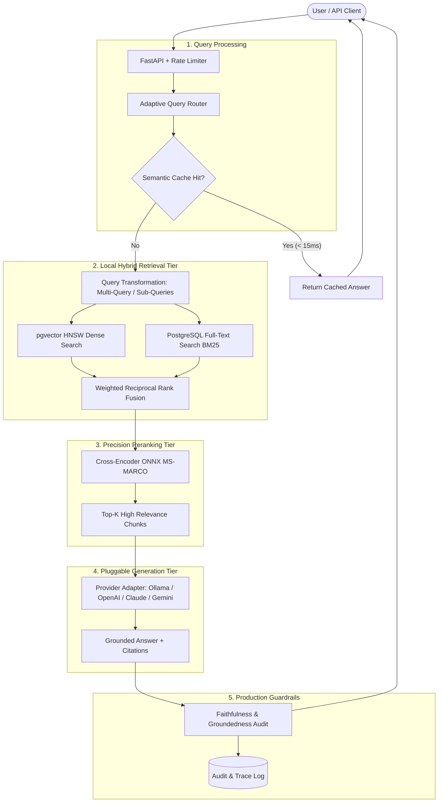
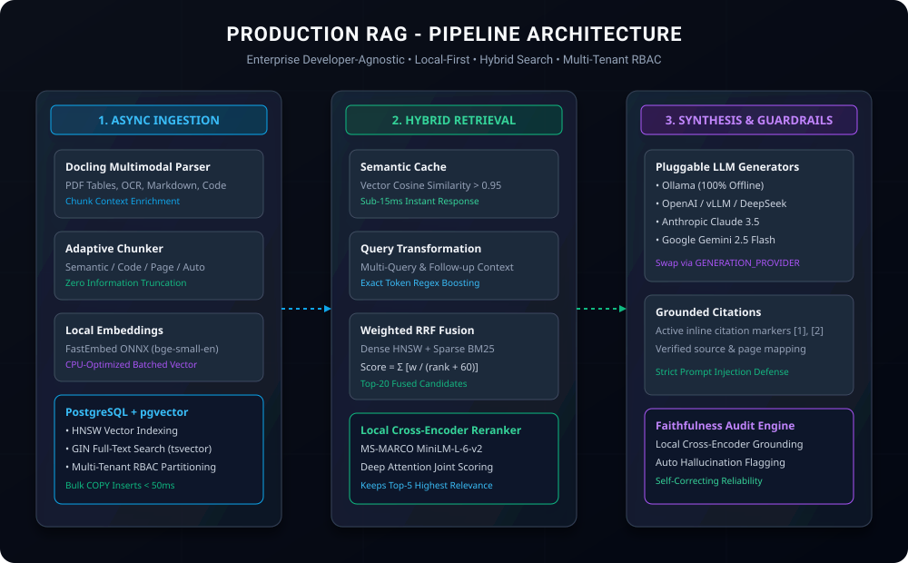

<div align="center">

# ⚡ Production RAG

### The Developer-Agnostic, Local-First Enterprise RAG Engine
**Hybrid Search (pgvector + BM25) • Cross-Encoder Reranking • Pluggable LLMs • Hierarchical Multi-Tenancy**

[](https://opensource.org/licenses/Apache-2.0)
[](https://www.python.org/)
[](docker-compose.yml)
[](CONTRIBUTING.md)
[](#)

<p align="center">
  <a href="#-quickstart-in-60-seconds">Quickstart</a> •
  <a href="#-why-production-rag">Why Production RAG?</a> •
  <a href="#-architecture">Architecture</a> •
  <a href="#-pluggable-providers">Providers</a> •
  <a href="#-cli-tooling">CLI</a> •
  <a href="#-benchmarks">Benchmarks</a> •
  <a href="CONTRIBUTING.md">Contributing</a>
</p>

</div>

---

## 🚀 Quickstart in 60 Seconds

Run a full-featured, enterprise-grade RAG stack locally with **zero external cloud dependencies**:

### Option A: Docker Compose (All-in-One)
```bash
# 1. Clone the repository
git clone https://github.com/njNagaraj/RAG-production.git
cd RAG-production

# 2. Start PostgreSQL with pgvector & API
docker compose up -d

# (Optional) If you want a bundled local Ollama instance inside Docker:
# docker compose --profile local-llm up -d

# 3. Open your browser:
# 🖥️  UI Dashboard: http://localhost:8000
# 📚  Interactive Swagger API: http://localhost:8000/docs
```

### Option B: Local Developer CLI (`rag`)
```bash
# 1. Install package in virtual environment
pip install -e ".[all]"

# 2. Check system health
rag doctor

# 3. Ingest bundled sample knowledge base in 5 seconds
rag ingest ./sample_documents/

# 4. Query with grounded citations and latency metrics
rag query "What is the annual lodging budget for L3 employees?"

# 5. Run continuous evaluation suite against golden test cases
rag eval
```

---

## 💡 Why Production RAG?

Most RAG tutorials break down the moment they hit production. Generic frameworks are bloated, slow, hard to self-host, and lack tenant isolation. **Production RAG** was built from day one for real-world enterprise deployment:

| Feature | ⚡ **Production RAG** | LangChain / LlamaIndex | Dify / RAGFlow |
|---|:---:|:---:|:---:|
| **Zero-Touch 100% Offline Mode** | ✅ Yes (Auto-probes Local Ollama) | ⚠️ Complex setup | ⚠️ Heavyweight |
| **Real-Time Token Streaming (SSE)** | ✅ Native Server-Sent Events | ⚠️ Framework dependent | ⚠️ Heavyweight |
| **Hybrid Search (Dense + BM25 RRF)** | ✅ Built-in native SQL | ⚠️ Requires external plugins | ⚠️ Resource heavy |
| **CPU-Optimized Reranking** | ✅ Built-in Cross-Encoder | ❌ External API calls | ⚠️ Partial |
| **Hierarchical Multi-Tenancy** | ✅ Org → Dept → Team → User | ❌ None | ⚠️ Basic Org only |
| **Semantic Response Cache** | ✅ Built-in (Role-Isolated) | ❌ DIY | ❌ No RBAC bounds |
| **Built-in Faithfulness Guardrail**| ✅ Self-auditing evaluator | ❌ Requires 3rd-party SaaS | ❌ No |
| **Continuous Evaluation Harness** | ✅ Built-in (`rag eval`) | ❌ Requires external tool | ❌ No |
| **Memory Footprint** | ⚡ **< 500MB RAM** | ⚠️ Heavy (> 2GB) | ⚠️ Very Heavy (> 4GB) |
| **Startup Latency** | ⚡ **< 2 seconds** | ⚠️ 10-20s | ⚠️ 1-2 minutes |

---

## 🏛️ System Architecture



<p align="center">
  
</p>

---

## 🔌 Pluggable Providers (Developer-Agnostic)

Swap your LLM or Embedder with a single environment variable in `.env`:

```ini
# Choose your preferred LLM backend
GENERATION_PROVIDER=ollama      # ollama | openai | anthropic | gemini | groq | deepseek | mock

# Choose your embedding provider
EMBEDDING_PROVIDER=local        # local (ONNX CPU) | openai | gemini | ollama
```

### Supported Providers:
- 🦙 **Ollama** — 100% offline, private, zero API key required (`llama3.2`, `mistral`, `deepseek-r1`).
- 🤖 **OpenAI** — Native GPT-4o, GPT-4o-mini, and any OpenAI-compatible API (vLLM, Together, LocalAI).
- 🧠 **Anthropic** — Claude 3.5 Sonnet and Claude 3.5 Haiku.
- ✨ **Google Gemini** — Gemini 2.5 Flash.
- ⚡ **Groq & DeepSeek** — Ultra-fast inference endpoints.
- 🧪 **Mock Generator** — Deterministic offline generation for CI/CD and zero-touch testing.

---

## 🔒 100% Local Mode

Every stage has a local backend. Defaults are local except where noted.

| Stage | Local backend | Opt-in cloud |
|---|---|---|
| Generation | Ollama (`auto` probes it first), any OpenAI-compatible server on localhost | OpenAI, Anthropic, Gemini, Groq, DeepSeek |
| Embedding | fastembed ONNX `bge-small-en-v1.5`, Ollama | OpenAI, Gemini |
| Reranking + faithfulness | fastembed ONNX cross-encoder | Cohere |
| Parsing, tables, OCR | Docling | none |
| Chart/image description | Ollama vision (`llama3.2-vision`) | Gemini (`VISION_PROVIDER=gemini`) |
| Web UI | system fonts, no CDN | none |

Air-gapped setup:

```bash
rag models pull                 # embedder, reranker, tokenizer, Docling models
ollama pull llama3.2 && ollama pull llama3.2-vision
export HF_HUB_OFFLINE=1         # block every runtime download
rag doctor                      # section [4] lists any stage that can leave the host
```

The Docker image bakes all models at build time and sets `HF_HUB_OFFLINE=1`.
Library telemetry is off by default: onnxruntime 1.29 otherwise reports each model load to Microsoft.

---

## 🛠️ CLI Tooling (`rag`)

Production RAG ships with a battle-tested developer CLI:

```bash
# Ingest single file or recursive directory
rag ingest ./knowledge_base/ --org acme-corp

# Ask questions with instant evaluation metrics
rag query "What are the reimbursement limits for travel?"

# Run automated system diagnostics (includes a data-locality check)
rag doctor

# Download every local model once, for offline or air-gapped hosts
rag models pull

# Benchmark hybrid retrieval and reranking latency
rag benchmark

# Retrieval quality on a public BEIR dataset (nDCG@10, Recall@10, MRR@10)
rag bench --dataset scifact

# Run golden dataset continuous evaluation suite
rag eval

# Launch production server with live reloading
rag serve --port 8000 --reload
```

---

## 📊 Benchmarks

Measured with `rag bench --dataset scifact` on BEIR SciFact: 5,183 abstracts, 300 test queries, 4 CPU threads, no GPU.
Every row runs the real pipeline: Chunker, local embedder, Postgres, RRF, local cross-encoder.

| Method | nDCG@10 | Recall@10 | MRR@10 | p50 | p95 |
|---|---|---|---|---|---|
| Postgres full-text search | 0.606 | 0.723 | 0.578 | 58 ms | 138 ms |
| Dense (`bge-small-en-v1.5`) | 0.702 | 0.833 | 0.669 | 107 ms | 139 ms |
| Hybrid (dense + FTS, RRF) | 0.694 | 0.827 | 0.660 | 180 ms | 291 ms |
| Hybrid + rerank (`ms-marco-MiniLM-L-6-v2`) | 0.687 | 0.821 | 0.652 | 2558 ms | 3061 ms |

On SciFact, dense alone scores highest. Equal-weight RRF and the MS MARCO reranker each cost about 0.01 nDCG.
Published references: BM25 0.665, `bge-small-en-v1.5` 0.713. Raw results: [`benchmarks/beir_scifact.json`](benchmarks/beir_scifact.json).

Reproduce: `pip install -e ".[bench]"`, then `rag bench --dataset scifact`. Any BEIR dataset name works, e.g. `nfcorpus` or `fiqa`.

---

## 🏢 Enterprise Multi-Tenancy & RBAC

Production RAG provides true hierarchical data isolation directly at the database layer:

```
Organization (e.g. Acme Corp)
 └── Department (e.g. Finance)
      └── Team (e.g. Payroll)
           └── Users (Owner | Admin | Editor | Viewer)
```

- **Row-Level Security**: Every document, chunk, cache entry, and audit event carries an `org_id` and `unit_id`.
- **Granular API Keys**: Salted and hashed per user with automatic brute-force IP rate-limiting.
- **Cache Isolation**: Semantic cache keys are partition-bounded to prevent unauthorized data leaks between departments.
- **Filter Before Ranking**: Both search legs apply the permission filter inside SQL. A scope of 10,000 chunks or fewer gets an exact vector scan, so a small team still receives a full top-k. Larger scopes use pgvector 0.8 iterative HNSW scans.

---

## 🤝 Contributing

We welcome community contributions! Whether it's adding a new vector store adapter (Qdrant, Milvus, Chroma), new parsers, or UI themes:

1. Read our [Contributing Guidelines](CONTRIBUTING.md).
2. Check open issues labeled [`good first issue`](https://github.com/njNagaraj/RAG-production/issues).
3. Submit a Pull Request!

---

## 📄 License

This project is licensed under the **Apache 2.0 License** - see the [LICENSE](LICENSE) file for details.
